<!-- logo:begin -->
<div align="center">
  <picture>
    <source media="(prefers-color-scheme: dark)" srcset="docs/media/climb-mark-dark.png">
    
  </picture>
</div>
<!-- logo:end -->

# CLIMB — Cryptographic Ladder Impact Measurement Benchmark

<!-- badges:begin -->
<div align="center">
  <a href="https://portal.aiori.in/aiori-3/hackathon-guideline/" target="_blank" rel="noopener"></a>
  <a href="https://portal.aiori.in/aiori-3/hackathon-guideline/" target="_blank" rel="noopener"></a>
  <a href="https://portal.aiori.in/aiori-3/hackathon-guideline/" target="_blank" rel="noopener"></a>
  <br>
  <a href="https://www.rust-lang.org/" target="_blank" rel="noopener"></a>
  <a href="https://www.youtube.com/watch?v=gDHYamjWmtE" target="_blank" rel="noopener"></a>
  <a href="docs/deck-facts.md" target="_blank" rel="noopener"></a>
</div>
<!-- badges:end -->

**Team Name**: CLIMB

**Team Code**: A3-PS036-TC529

**Team Members**: [Pratyay Mukherjee](https://github.com/profm0r14rty), [Mohit Kumar Yadav](https://github.com/Mohh12glitch), [Dr. Maibam Devi](https://www.nfsu.ac.in/Faculty/profile/664) (Faculty Mentor)

**Team CLIMB Presentation deck in pdf format**: check [`A3-PS036-TC529.pdf`](A3-PS036-TC529.pdf)

**YouTube Video Link**: [Team CLIMB introduction video](https://www.youtube.com/watch?v=gDHYamjWmtE)

**AIORI-3 Hackathon PS-036**: Benchmarking Merkle Tree Ladder (MTL) mode for post-quantum
DNSSEC signing (SLH-DSA), comparing signing with MTL amortization against signing without.

## The pitch, in thirty seconds

Post-quantum DNSSEC signatures are big; signing a whole batch of records with
SLH-DSA is slow; and shipping a full signature with every DNS response does not
fit in UDP. MTL mode signs a Merkle tree ladder once for a whole batch, so most
responses carry only a small condensed authentication path instead of a full
signature. CLIMB is a reproducible benchmark suite — not an argument — that
measures what that amortisation actually buys and what it costs, using the
supplied Verisign reference implementation (libMTL) under a pinned environment,
three dataset sizes, repeated trials, and a live DNS pipeline (patched NSD and
Unbound in local Docker) that captures real wire bytes. Every number in this
README, the HTML report and the dashboard is read from a recorded artifact,
never typed into source, and every claim carries its evidence class: measured,
derived, analytical or extrapolated.

## Built in the open

<!-- commit-graph:begin -->
<a href="https://github.com/aiori-hackathon/A3-PS036-TC529/commit/f94fc6a53b0c1363edbc9eae95868cb782b3cfcb" target="_blank" rel="noopener">
<picture>
  <source media="(max-width: 600px)" srcset="docs/media/commit-graph-narrow.svg" width="390">
  
</picture>
</a>

Every commit, every quiet day and the roadmap milestones behind this benchmark
suite, read from the public commit history of this repository.

Generated by `cargo xtask commit-graph` from the public history of
aiori-hackathon/A3-PS036-TC529, as of the commit shown in the image; later
commits appear after the next refresh.
<!-- commit-graph:end -->

## Headline results

Every value below is a verbatim quote from the generated quote sheet
[`docs/deck-facts.md`](docs/deck-facts.md), which reads the recorded artifacts
at generation time (`cargo xtask deck-facts`). The **Evidence class** column
says how each number was obtained and the **Baseline** column names what it is
compared against (A = plain SLH-DSA, B = MTL without amortisation, C = MTL
amortised — definitions in [`docs/BASELINES.md`](docs/BASELINES.md));
`≈` marks an extrapolated value. `cargo xtask docs-check` fails if any number
in this table drifts from the quote sheet.

<!-- headline:begin -->
| Metric | Value | Evidence class | Baseline |
| --- | --- | --- | --- |
| Live DNS response, `www.climb.example. A` — reduction, condensed vs full | 97.307 % | DERIVED | B |
| Wire bytes, Medium — C (MTL amortised) | 2,743,352 B | MEASURED | C |
| Wire bytes, Medium — B (MTL, no amortisation) | 83,295,296 B | MEASURED | B |
| Wire bytes, Medium — A (plain SLH-DSA) | 78,560,000 B | MEASURED | A |
| Wire reduction, Medium — C vs B | 96.706 % | DERIVED | B |
| Signing speed-up, Medium — C vs B | ≈15,084 × | EXTRAPOLATED | B |
| Verifying speed-up, Medium, trust cached ladder — C vs A | ≈215.3 × | EXTRAPOLATED | A |
| Memory, Small — measured / analytical ratio | 1.90 × | DERIVED | n/a |
<!-- headline:end -->

Regenerate the sheet after any re-measurement with `cargo xtask deck-facts`;
the full table (every size, both time metrics, memory, ladder shape, DNS
capture rows) lives there with JSON pointers into the artifacts.

## Quickstart — clean clone to dashboard, three commands

```bash
git clone --recurse-submodules https://github.com/aiori-hackathon/A3-PS036-TC529 climb && cd climb
docker build -f docker/Dockerfile.build -t climb-builder:phase1 . && docker/extract-libs.sh
cargo run -p climb-tui
```

The first command clones the repository with its pinned submodules; the second
builds the pinned native toolchain (OpenSSL, liboqs, libMTL) in Docker and
extracts it into `.mtl-install/`, which the FFI build script finds
automatically; the third compiles the workspace and opens the dashboard. On a
fresh checkout the dashboard reads the committed sample results under
`docs/sample-output/`, so it renders immediately; point it at regenerated
artifacts with `cargo run -p climb-tui -- target/climb-results.json` after
`cargo xtask reproduce`.

## Baselines

Three configurations are compared throughout, and the labels are used
consistently across the report, charts, TUI and this README:

- **A — plain SLH-DSA** — one full SLH-DSA signature per RRset, no ladder:
  the DNSSEC status quo before any MTL wrapper.
- **B — MTL, no amortisation** — every message carries a complete MTL
  signature (its condensed path concatenated with the ladder).
- **C — MTL amortised** — one signed Merkle tree ladder is shared across the
  whole batch; each message carries only a condensed authentication path.

See [`docs/BASELINES.md`](docs/BASELINES.md) for the wire-byte formula of each
configuration and how the signing benchmark realises each one.

## How to read the report

The self-contained report (`target/climb-report/report.html`, regenerate with
`cargo xtask report --format html`) is built around a **claims registry**: every
claim embeds the JSON pointer into `target/climb-results.json` it was rendered
from, its expected value, and a pass/fail mark. Two drift checks keep the
rendered report honest:

- `cargo xtask report --check` re-resolves every claim against the current
  results document and fails loudly if the report and the artifact disagree
  (for example after re-running benchmarks without re-rendering).
- `cargo xtask docs-check` re-reads the quote sheet and fails if any numeric
  result in this README or `docs/` is not a value the quote sheet records, or
  if a documentation diagram names a crate or binary the workspace does not
  contain.

The TUI's Integrity tab runs the same claim check live. Numbers are always
labelled with their **evidence class** — measured, derived, analytical or
extrapolated (`≈`) — and with their baseline, exactly as in the headline table
above; the classes are defined in [`docs/METHODOLOGY.md`](docs/METHODOLOGY.md).

## Repository map

Eight workspace packages (seven crates plus the automation binary):

| Path | Role |
| --- | --- |
| `crates/climb-mtl-sys/` | Raw `bindgen` FFI bindings to the pinned libMTL |
| `crates/climb-mtl/` | Safe Rust wrapper over the FFI layer |
| `crates/climb-dns/` | Deterministic dataset generation, DNS wire/capture parsing |
| `crates/climb-analytical/` | Closed-form memory and UDP-fit models |
| `crates/climb-bench/` | Criterion benchmark groups, wire-size and memory probes |
| `crates/climb-report/` | Consolidation, charts, HTML report, claims registry |
| `crates/climb-tui/` | Terminal dashboard (live runs and recorded replay) |
| `xtask/` | `cargo xtask` automation: pin-env, bench-all, report, wire-report, memory-report, ladder-verify, dns-demo, consolidate, charts, deck-facts, docs-check, readme-badges, commit-graph, package, reproduce |

Supporting directories:

- `docker/` — Dockerfiles and compose files for the pinned toolchain build and
  the local-only DNS pipeline (NSD, Unbound, zone signer, scripted queries);
- `third_party/` — pinned submodules: `liboqs` and `MTL` (the reference
  implementation);
- `docs/` — `ARCHITECTURE.md`, `METHODOLOGY.md`, `BASELINES.md`,
  `RESEARCH.md` (reading list), the generated quote sheet `deck-facts.md`, and
  `sample-output/` (committed, provenance-stamped sample artifacts);
- `data/` — recorded fixtures (DNS capture, ladder verification);
- `scripts/` — environment pinning, clean-clone check helpers, the logo asset
  build, and the commit-graph refresh and hook-install scripts;
- `dist/` — release bundles written by `cargo xtask package` (gitignored).

## Development

```bash
cargo build --workspace
cargo fmt --check
cargo clippy --all-targets --all-features -- -D warnings
cargo test --workspace
cargo xtask docs-check
```

## Environment pinning

```bash
cargo xtask pin-env
```

Writes `environment.json` at the repository root with CPU model, kernel version,
Rust/Cargo versions, submodule commits, and other build-environment metadata.

## Reproduce

One command runs the whole artifact chain in order and leaves the report
self-check passing:

```bash
cargo xtask reproduce
```

It pins the environment, measures wire sizes and memory, optionally re-runs the
benchmark suite, captures the live DNS pipeline (or falls back to the committed
recorded capture), then consolidates, charts, renders and self-checks the
report. Each step's status and duration is printed, and the run stops at the
first failure with the failing step named. The final step is the report
self-check, so a zero exit means the artifacts and the rendered report agree.

| Flag | Effect |
|---|---|
| `--quick` | Limit every measurement to the Small and Medium datasets |
| `--bench` | Re-run the Criterion benchmark suite (default: reuse the last output) |
| `--skip-dns` | Skip the live DNS pipeline and use the recorded capture |
| `--force` | Accept optional inputs regardless of age when consolidating |

The live DNS step also runs only when Docker is available; otherwise the
recorded capture is used automatically.

## Release bundle

```bash
cargo xtask package
```

Writes `dist/climb-<short-sha>.tar.gz` containing everything a judge or mentor
needs to inspect the numbers without building: the self-contained
`report.html`, every report chart, `climb-results.json`, the quote sheet
`deck-facts.md`, the environment fingerprint, the recorded DNS and ladder
fixtures, a `SHA256SUMS` manifest over the payload, and a `PROVENANCE.txt`
naming the commit, submodule SHAs, toolchain, host-fingerprint hash and the
packing date. Packing fails when an input is missing or when the report
disagrees with the results it ships beside.

## Honest limits

CLIMB reports empirical measurements only: no formal security guarantee, proof
or certification is claimed for MTL mode, SLH-DSA or any component here.

- **One algorithm, one reference implementation.** Results cover
  SLH-DSA-SHA2-128s-MTL-SHA2-128 through the supplied libMTL; they may not
  transfer to other parameter sets, to ML-DSA, or to other implementations.
- **One machine.** All numbers were measured on a single laptop-class machine
  whose full fingerprint is recorded in `environment.json`; timings from other
  hardware will differ. The benchmark environment is pinned (fixed governor,
  CPU pinning) but residual thermal variance was observed and is documented
  rather than hidden.
- **Native SLH-DSA is not SIMD-tuned** in the pinned library build, so absolute
  signing times are dominated by that library's implementation choices; the
  with/without-MTL comparisons share the same implementation, which is what
  makes them fair.
- **Extrapolated values are marked `≈`.** Batch-scale costs for the largest
  datasets are the measured per-message cost times the message count, not
  end-to-end measurements of the whole batch; the identity was validated
  against an intermediate measured dataset size before being applied.
- **The live DNS pipeline runs locally only** — a Docker bridge network bound
  to localhost, with patched reference NSD and Unbound builds; there is no
  Internet deployment and no resolver was written from scratch.
