<!-- logo:begin -->
<div align="center">
  <picture>
    <source media="(prefers-color-scheme: dark)" srcset="docs/media/climb-mark-dark.png">
    
  </picture>
</div>
<!-- logo:end -->

# CLIMB — Cryptographic Ladder Impact Measurement Benchmark

A reproducible benchmark suite measuring the operational impact of Merkle Tree Ladder (MTL) mode applied to post-quantum DNSSEC signing (SLH-DSA), comparing signing with MTL amortization against signing without.

<!-- badges:begin -->
<div align="center">
  <a href="https://portal.aiori.in/aiori-3/hackathon-guideline/" target="_blank" rel="noopener"></a>
  <a href="https://portal.aiori.in/aiori-3/hackathon-guideline/" target="_blank" rel="noopener"></a>
  <a href="https://portal.aiori.in/aiori-3/hackathon-guideline/" target="_blank" rel="noopener"></a>
  <br>
  <a href="https://www.rust-lang.org/" target="_blank" rel="noopener"></a>
  <a href="https://www.youtube.com/watch?v=gDHYamjWmtE" target="_blank" rel="noopener"></a>
  <a href="docs/deck-facts.md" target="_blank" rel="noopener"></a>
</div>
<!-- badges:end -->


<!-- commit-graph-strip:begin -->
<div align="center">
<a href="https://github.com/aiori-hackathon/A3-PS036-TC529/commit/01e6320dc982f878eda56a01d480dafab2959a92" target="_blank" rel="noopener">
<picture>
  <source media="(max-width: 600px)" srcset="docs/media/commit-graph-compact-narrow.svg" width="390">
  
</picture>
</a>
</div>
<!-- commit-graph-strip:end -->


<!-- demo-video:begin -->
<div align="center">

### Watch the demo

</div>

https://github.com/user-attachments/assets/a3ded014-acba-4165-9750-ee3282d5b52c

<div align="center">
<sub><a href="docs/media/CLIMB-TUI-demo-video.mp4">Download the recording</a> · <a href="https://www.youtube.com/watch?v=gDHYamjWmtE">Team introduction on YouTube</a></sub>
</div>
<!-- demo-video:end -->


**Jump to:** [Demo video](#watch-the-demo) · [Judge fast path](#judge-fast-path) · [Live demo](#live-demo) · [Headline results](#headline-results) · [Built in the open](#built-in-the-open) · [Quickstart](#quickstart) · [Run the dashboard](#run-the-dashboard-on-your-machine) · [Baselines](#baselines) · [How to read the report](#how-to-read-the-report) · [Repository map](#repository-map) · [Honest limits](#honest-limits)


| Name | Role | Link |
| :--- | :--- | :--- |
| [Pratyay Mukherjee](https://github.com/profm0r14rty) | Team Lead and Developer | [GitHub](https://github.com/profm0r14rty) |
| [Mohit Kumar Yadav](https://github.com/Mohh12glitch) | Lead Researcher | [GitHub](https://github.com/Mohh12glitch) |
| [Dr. Maibam Devi](https://www.nfsu.ac.in/Faculty/profile/664) | Faculty Mentor | [NFSU profile](https://www.nfsu.ac.in/Faculty/profile/664) |

**Team Name:** CLIMB  
**Team Code:** A3-PS036-TC529  
**Presentation:** [`A3-PS036-TC529.pdf`](A3-PS036-TC529.pdf)  
**Introduction video:** [Team CLIMB introduction video](https://www.youtube.com/watch?v=gDHYamjWmtE)

## Judge fast path

- [**Report (HTML)**](docs/sample-output/report.html) — Self-contained results report with claims registry and drift checks
- [**Deck PDF**](A3-PS036-TC529.pdf) — Team presentation deck
- [**Intro video**](https://www.youtube.com/watch?v=gDHYamjWmtE) — Team CLIMB introduction
- [**Quickstart**](#quickstart) — Prebuilt viewer, container, or a full native build
- [**Honest limits**](#honest-limits) — Empirical measurements only; no formal guarantees

## Live demo

<!-- live:begin -->
Live demo: coming with the web release
<!-- live:end -->

## Headline results

Every value below is a verbatim quote from the generated quote sheet
[`docs/deck-facts.md`](docs/deck-facts.md), which reads the recorded artifacts
at generation time (`cargo xtask deck-facts`). The **Evidence class** column
says how each number was obtained and the **Baseline** column names what it is
compared against (A = plain SLH-DSA, B = MTL without amortisation, C = MTL
amortised — definitions in [`docs/BASELINES.md`](docs/BASELINES.md));
`≈` marks an extrapolated value. `cargo xtask docs-check` fails if any number
in this table drifts from the quote sheet.

<!-- headline:begin -->
| Metric | Value | Evidence class | Baseline | Spread |
| --- | --- | --- | --- | --- |
| Live DNS response, `www.climb.example. A` — reduction, condensed vs full | 97.307 % | DERIVED | B | — |
| Wire reduction, Medium — C vs A | 96.508 % | DERIVED | A | — |
| Wire bytes, Medium — A (plain SLH-DSA) | 78,560,000 B | MEASURED | A | — |
| Wire bytes, Medium — B (MTL, no amortisation) | 83,295,296 B | MEASURED | B | — |
| Wire bytes, Medium — C (MTL amortised) | 2,743,352 B | MEASURED | C | — |
| Signing speed-up, Medium — C vs A | 9405 × | DERIVED | A | — |
| Verifying speed-up, Medium, trust cached ladder — C vs A | 215.3 × | DERIVED | A | — |
| UDP fit (how many modelled rows each of A,B,C fits within MTU) | 0.000 % | ANALYTICAL | n/a | — |
| Large memory (measured resident median) | 1,087,139,840 B | MEASURED | n/a | — |
| Large memory (measured / analytical ratio) | 1.10 × | DERIVED | n/a | — |
| Ladder shape | 132 B | MEASURED | n/a | — |
<!-- headline:end -->

Regenerate the sheet after any re-measurement with `cargo xtask deck-facts`;
the full table (every size, both time metrics, memory, ladder shape, DNS
capture rows) lives there with JSON pointers into the artifacts.

## Built in the open

<!-- commit-graph:begin -->
<a href="https://github.com/aiori-hackathon/A3-PS036-TC529/commit/01e6320dc982f878eda56a01d480dafab2959a92" target="_blank" rel="noopener">
<picture>
  <source media="(max-width: 600px)" srcset="docs/media/commit-graph-narrow.svg" width="390">
  
</picture>
</a>

Every commit, every quiet day and the roadmap milestones behind this benchmark
suite, read from the public commit history of this repository.

Generated by `cargo xtask commit-graph` from the public history of
aiori-hackathon/A3-PS036-TC529, as of the commit shown in the image; later
commits appear after the next refresh.
<!-- commit-graph:end -->

## Quickstart

<!-- quickstart:begin -->
The dashboard is a read-only viewer: it parses recorded artifacts and links no
native crypto stack. There are two ways in, and only the second one needs a
compiler at all.

### Fastest path — prebuilt viewer or container

Download the viewer tarball from the latest release and run the binary, or run
the published container image:

```bash
tar -xzf climb-tui-*.tar.gz && ./climb-tui-*/climb-tui --tour
docker run -it --rm climb-tui:latest
```

The tarball is produced from this checkout with `cargo xtask dist-tui`; the
image is built with `docker build -f docker/Dockerfile.tui -t climb-tui .`.
Both compile the sample results,
the recorded DNS capture and the recorded ladder verification into the binary,
so the dashboard renders with no checkout, no native prefix and no network.
The status bar names which source it read: `[embedded]`, `[sample]`,
`[target]` or `[explicit]`.

### Full reproduction — build the native stack

```bash
git clone --recurse-submodules https://github.com/aiori-hackathon/A3-PS036-TC529 climb && cd climb
docker build -f docker/Dockerfile.build -t climb-builder:phase1 . && docker/extract-libs.sh
cargo run -p climb-tui
```
<!-- quickstart:end -->

The first command clones the repository with its pinned submodules; the second
builds the pinned native toolchain (OpenSSL, liboqs, libMTL) in Docker and
extracts it into `.mtl-install/`, which the FFI build script finds
automatically; the third compiles the workspace and opens the dashboard. On a
fresh checkout the dashboard reads the committed sample results under
`docs/sample-output/`, so it renders immediately; point it at regenerated
artifacts with `cargo run -p climb-tui -- target/climb-results.json` after
`cargo xtask reproduce`.

## Run the dashboard on your machine

<!-- tui-guide:begin -->
The dashboard is a terminal application written in Rust. It is read-only: it
loads the recorded results in this repository, needs no network, and does not
link the native cryptographic stack, so it builds without Docker. It was
developed and tested on Linux; other platforms are untested.

### Install

Pick one. They produce the same program.

**A. Run from a clone** (needs [Rust](https://rustup.rs); the pinned toolchain installs itself)

```bash
git clone https://github.com/aiori-hackathon/A3-PS036-TC529 climb && cd climb
cargo run --release -p climb-tui --no-default-features
```

**B. Install the binary onto your PATH**

```bash
cargo install --locked --git https://github.com/aiori-hackathon/A3-PS036-TC529 climb-tui --no-default-features
climb-tui
```

**C. In a container** (needs Docker)

```bash
git clone https://github.com/aiori-hackathon/A3-PS036-TC529 climb && cd climb
docker build -f docker/Dockerfile.tui -t climb-tui .
docker run -it --rm climb-tui
```

### The nine views

Move with `Tab` and `Shift-Tab`, or jump straight to a view with the number keys.

| View | What it shows |
| --- | --- |
| **Overview** | Headline cards for the live DNS response, wire size and speed-ups; a table comparing Ed25519, ECDSA P-256 and RSA-2048 (classical, shown for context only and not quantum-resistant) with plain SLH-DSA and the two MTL modes: signature bytes, sign and verify time, and whether the signature fits one UDP packet; the build environment; how fresh each artifact is |
| **Signing** | Total signing time per dataset size for MTL amortised against no amortisation, an amortisation curve (time per message against batch size), and a table per size |
| **Verifying** | Verification time per dataset size for the full ladder, without MTL, and with a trusted cached ladder, plus a cold-versus-warm table for reusing a validated ladder |
| **Wire** | Bytes on the wire per dataset size for the three configurations, the range of condensed-signature sizes, the single-answer fit from the live capture, and a modelled UDP-fit table across response profiles and batch sizes |
| **Memory** | Measured resident memory against the analytical model for each dataset size, and what the model counts |
| **Ladder** | A Merkle tree ladder drawn for a small batch; walk the leaves to see each leaf's authentication path and a badge saying whether the model matches the library's own output |
| **Live** | A recorded DNS exchange replayed packet by packet, without MTL and with MTL side by side, with running byte totals |
| **Integrity** | Re-checks every claim in the report against the results, shows provenance and which artifacts are stale, and explains the evidence classes |
| **Method** | A scrollable document: scope, the three baselines, evidence classes, environment and pinning, sampling and extrapolation, known limits |

Measured, extrapolated and analytical values are drawn in different colours;
extrapolated values are also marked with `≈`.

### Keys

| Key | Action |
| --- | --- |
| `Tab` / `Shift-Tab` | Next or previous view |
| `1` … `9` | Jump to a view by number |
| `←` / `→` | Select the dataset size |
| `v` | Switch between total time and time per message |
| `↑` / `↓` | Ladder: move between leaves. Integrity and Method: scroll |
| `Space` | Ladder: show or hide the signature banner |
| `Enter` | Ladder: auto-play the leaves |
| `Space` / `Backspace` | Live: next or previous step |
| `Enter` | Live: auto-play the replay |
| `t` | Live: switch between logarithmic and linear byte scale |
| `r` | Reload the results from disk (on Integrity this also re-runs the claim check) |
| `T` | Cycle the theme: dark, light, contrast |
| `a` | Toggle ASCII glyphs, for terminals with poor fonts |
| `?` | Show or hide the help overlay |
| `q` / `Esc` / `Ctrl-C` | Quit |

The status bar at the bottom shows the theme and colour depth, ASCII mode, tour
state and which data file is loaded.

### Guided tour

```bash
cargo run --release -p climb-tui --no-default-features -- --tour
```

The tour walks through the views on a script. `p` pauses, `n` moves to the next
step and `Esc` ends the tour. `--tour-speed` changes the pace.

### Which data it reads

In order: a path you pass, `target/climb-results.json`, `docs/sample-output/`,
and finally the copy compiled into the program. The status bar names the one in
use: `[explicit]`, `[target]`, `[sample]` or `[embedded]`. To use your own
results, run `cargo xtask reproduce`, start the dashboard with the path
`target/climb-results.json`, and press `r` after any later run to reload.

### Terminal tips

- It needs a real terminal of at least 80 columns by 24 rows; a full-screen window is best.
- Use a terminal with truecolor support. Inside tmux, add `set -as terminal-overrides ',*:RGB'` to `~/.tmux.conf`.
- If glyphs render badly press `a`; if colours are hard to read press `T`.
- Running it through a pipe or an editor's task runner fails with a raw-mode error.
- The Live view replays a recording. Recording a fresh one needs the full native build and Docker: `cargo xtask dns-demo`.
- To reproduce the measurements themselves, see [Full reproduction](#full-reproduction--build-the-native-stack).
<!-- tui-guide:end -->

## Baselines

Three configurations are compared throughout, and the labels are used
consistently across the report, charts, TUI and this README:

- **A — plain SLH-DSA** — one full SLH-DSA signature per RRset, no ladder:
  the DNSSEC status quo before any MTL wrapper.
- **B — MTL, no amortisation** — every message carries a complete MTL
  signature (its condensed path concatenated with the ladder).
- **C — MTL amortised** — one signed Merkle tree ladder is shared across the
  whole batch; each message carries only a condensed authentication path.

See [`docs/BASELINES.md`](docs/BASELINES.md) for the wire-byte formula of each
configuration and how the signing benchmark realises each one.

## How to read the report

The self-contained report (`target/climb-report/report.html`, regenerate with
`cargo xtask report --format html`) is built around a **claims registry**: every
claim embeds the JSON pointer into `target/climb-results.json` it was rendered
from, its expected value, and a pass/fail mark. Two drift checks keep the
rendered report honest:

- `cargo xtask report --check` re-resolves every claim against the current
  results document and fails loudly if the report and the artifact disagree
  (for example after re-running benchmarks without re-rendering).
- `cargo xtask docs-check` re-reads the quote sheet and fails if any numeric
  result in this README or `docs/` is not a value the quote sheet records, or
  if a documentation diagram names a crate or binary the workspace does not
  contain.

The TUI's Integrity tab runs the same claim check live. Numbers are always
labelled with their **evidence class** — measured, derived, analytical or
extrapolated (`≈`) — and with their baseline, exactly as in the headline table
above; the classes are defined in [`docs/METHODOLOGY.md`](docs/METHODOLOGY.md).

## Repository map

Eight workspace packages (seven crates plus the automation binary):

| Path | Role |
| --- | --- |
| `crates/climb-mtl-sys/` | Raw `bindgen` FFI bindings to the pinned libMTL |
| `crates/climb-mtl/` | Safe Rust wrapper over the FFI layer |
| `crates/climb-dns/` | Deterministic dataset generation, DNS wire/capture parsing |
| `crates/climb-analytical/` | Closed-form memory and UDP-fit models |
| `crates/climb-bench/` | Criterion benchmark groups, wire-size and memory probes |
| `crates/climb-report/` | Consolidation, charts, HTML report, claims registry |
| `crates/climb-tui/` | Terminal dashboard (live runs and recorded replay) |
| `xtask/` | `cargo xtask` automation: pin-env, bench-all, report, wire-report, memory-report, ladder-verify, dns-demo, consolidate, charts, deck-facts, docs-check, readme-badges, commit-graph, package, reproduce |

Supporting directories:

- `docker/` — Dockerfiles and compose files for the pinned toolchain build and
  the local-only DNS pipeline (NSD, Unbound, zone signer, scripted queries);
- `third_party/` — pinned submodules: `liboqs` and `MTL` (the reference
  implementation);
- `docs/` — `ARCHITECTURE.md`, `METHODOLOGY.md`, `BASELINES.md`,
  `RESEARCH.md` (reading list), the generated quote sheet `deck-facts.md`, and
  `sample-output/` (committed, provenance-stamped sample artifacts);
- `data/` — recorded fixtures (DNS capture, ladder verification);
- `scripts/` — environment pinning, clean-clone check helpers, the logo asset
  build, and the commit-graph refresh and hook-install scripts;
- `dist/` — release bundles written by `cargo xtask package` (gitignored).

<details><summary>Development</summary>

### Development

```bash
cargo build --workspace
cargo fmt --check
cargo clippy --all-targets --all-features -- -D warnings
cargo test --workspace
cargo xtask docs-check
```

</details>

<details><summary>Environment pinning</summary>

### Environment pinning

```bash
cargo xtask pin-env
```

Writes `environment.json` at the repository root with CPU model, kernel version,
Rust/Cargo versions, submodule commits, and other build-environment metadata.

</details>

<details><summary>Reproduce</summary>

### Reproduce

One command runs the whole artifact chain in order and leaves the report
self-check passing:

```bash
cargo xtask reproduce
```

It pins the environment, measures wire sizes and memory, optionally re-runs the
benchmark suite, captures the live DNS pipeline (or falls back to the committed
recorded capture), then consolidates, charts, renders and self-checks the
report. Each step's status and duration is printed, and the run stops at the
first failure with the failing step named. The final step is the report
self-check, so a zero exit means the artifacts and the rendered report agree.

| Flag | Effect |
|---|---|
| `--quick` | Limit every measurement to the Small and Medium datasets |
| `--bench` | Re-run the Criterion benchmark suite (default: reuse the last output) |
| `--skip-dns` | Skip the live DNS pipeline and use the recorded capture |
| `--force` | Accept optional inputs regardless of age when consolidating |

The live DNS step also runs only when Docker is available; otherwise the
recorded capture is used automatically.

</details>

<details><summary>Release bundle</summary>

### Release bundle

```bash
cargo xtask package
```

Writes `dist/climb-<short-sha>.tar.gz` containing everything a judge or mentor
needs to inspect the numbers without building: the self-contained
`report.html`, every report chart, `climb-results.json`, the quote sheet
`deck-facts.md`, the environment fingerprint, the recorded DNS and ladder
fixtures, a `SHA256SUMS` manifest over the payload, and a `PROVENANCE.txt`
naming the commit, submodule SHAs, toolchain, host-fingerprint hash and the
packing date. Packing fails when an input is missing or when the report
disagrees with the results it ships beside.

</details>

## Honest limits

CLIMB reports empirical measurements only: no formal security guarantee, proof
or certification is claimed for MTL mode, SLH-DSA or any component here.

- **One algorithm, one reference implementation.** Results cover
  SLH-DSA-SHA2-128s-MTL-SHA2-128 through the supplied libMTL; they may not
  transfer to other parameter sets, to ML-DSA, or to other implementations.
- **One machine.** All numbers were measured on a single laptop-class machine
  whose full fingerprint is recorded in `environment.json`; timings from other
  hardware will differ. The benchmark environment is pinned (fixed governor,
  CPU pinning) but residual thermal variance was observed and is documented
  rather than hidden.
- **Native SLH-DSA is not SIMD-tuned** in the pinned library build, so absolute
  signing times are dominated by that library's implementation choices; the
  with/without-MTL comparisons share the same implementation, which is what
  makes them fair.
- **Extrapolated values are marked `≈`.** Batch-scale costs for the largest
  datasets are the measured per-message cost times the message count, not
  end-to-end measurements of the whole batch; the identity was validated
  against an intermediate measured dataset size before being applied.
- **The live DNS pipeline runs locally only** — a Docker bridge network bound
  to localhost, with patched reference NSD and Unbound builds; there is no
  Internet deployment and no resolver was written from scratch.

<!-- footer:begin -->

---

<div align="center">
  <picture>
    <source media="(prefers-color-scheme: dark)" srcset="docs/media/climb-icon.png">
    
  </picture>
</div>

<sub>CLIMB - Cryptographic Ladder Impact Measurement Benchmark</sub>  
<sub>Team A3-PS036-TC529 - AIORI-3 Hackathon - PS-036 - Track 2 Cyber Security</sub>  
<sub>[Report](docs/sample-output/report.html) · [Deck](A3-PS036-TC529.pdf) · [Intro video](https://www.youtube.com/watch?v=gDHYamjWmtE) · [Methodology](docs/METHODOLOGY.md) · [Honest limits](#honest-limits) · [Licence](LICENSE) · [Back to top](#climb--cryptographic-ladder-impact-measurement-benchmark)</sub>  
<sub>Built on the Verisign Labs libMTL reference implementation, liboqs from Open Quantum Safe, NSD and Unbound from NLnet Labs</sub>

<div align="center">
  <sub><em>Measured, not claimed.</em></sub>
</div>

<!-- footer:end -->
