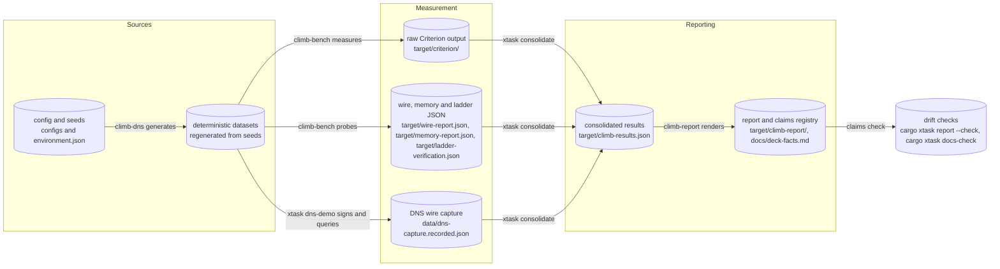

# Architecture

CLIMB is a single-language Rust workspace around a pinned C toolchain. This
document describes the moving parts, one live DNS query end to end, and where
every piece of data lives. Crate and binary names below are the real names from
`cargo metadata`; `cargo xtask docs-check` enforces that the diagrams never
drift from them.

## Component and deployment

```mermaid
flowchart TB
  subgraph native["Pinned native toolchain (third_party submodules, Docker build)"]
    openssl["OpenSSL 3.4.1 (pinned in the Dockerfile)"]
    liboqs["liboqs 0.16.0 (submodule third_party/liboqs)"]
    libmtl["libMTL (submodule third_party/MTL)"]
  end

  subgraph workspace["Rust workspace"]
    climb_mtl_sys["climb-mtl-sys (bindgen FFI bindings)"]
    climb_mtl["climb-mtl (safe wrapper)"]
    climb_dns["climb-dns (datasets, capture parsing)"]
    climb_analytical["climb-analytical (memory and UDP-fit models)"]
    climb_bench["climb-bench (Criterion groups, wire and memory probes)"]
    climb_report["climb-report (consolidation, charts, HTML, claims)"]
    climb_tui["climb-tui (dashboard, replay, integrity check)"]
    xtask["xtask (automation: pin-env, reproduce, docs-check, ...)"]
  end

  subgraph docker_net["Docker bridge network, localhost only"]
    signer["signer (patched ldns zone signer)"]
    nsd["nsd (patched authoritative server)"]
    unbound["unbound (patched recursive resolver)"]
    dig_client["dig (scripted queries, wire capture)"]
  end

  artifacts[("artifacts: target/climb-results.json, target/wire-report.json, target/memory-report.json, target/ladder-verification.json, target/criterion/, target/climb-report/)"]

  openssl --> liboqs --> libmtl
  libmtl --> climb_mtl_sys --> climb_mtl
  climb_mtl --> climb_bench
  climb_dns --> climb_bench
  climb_mtl --> climb_dns
  climb_dns --> climb_analytical
  climb_bench --> climb_report
  climb_analytical --> climb_report
  climb_dns --> climb_report
  climb_report --> climb_tui
  climb_report --> artifacts
  climb_bench --> artifacts
  xtask --> climb_bench
  xtask --> climb_report

  signer --> nsd --> unbound --> dig_client
  dig_client --> artifacts
  climb_dns --> signer
```

The native stack is pinned three ways: OpenSSL and liboqs are built inside
`docker/Dockerfile.build` from pinned sources, `third_party/liboqs` and
`third_party/MTL` are git submodules pinned to exact commits, and
`cargo xtask pin-env` records those commits plus the toolchain and CPU details
in `environment.json`. The FFI crate resolves the install prefix
(`.mtl-install/` by default) through its build script, so the Rust workspace
links exactly the libraries the Docker build produced.

The live DNS pipeline runs only inside a Docker bridge network bound to
localhost (`docker/compose.dns-pipeline.yml`). The patched NSD, Unbound and
zone-signer builds are the reference implementations from the MTL
drafts; no resolver was written from scratch, and nothing is ever bound to a
public interface.

## One live query, cold and warm

A single `www.climb.example. A` lookup through the pipeline, first with no
cached ladder (cold) and then with a validated ladder in the resolver's cache
(warm). The two verification paths are exactly the two verifying conditions
the benchmark measures (`ladder re-validated` and `trust cached ladder`); the
byte counts are from the recorded capture.

```mermaid
sequenceDiagram
  autonumber
  participant client as "dig client"
  participant res as "unbound (recursive)"
  participant auth as "nsd (authoritative)"

  Note over auth: zone signed once by the signer; NSD holds the signed tree

  rect rgb(40, 40, 40)
    Note over client,res: Cold — resolver has no cached ladder
    client->>res: query www.climb.example. A
    res->>auth: query www.climb.example. A
    auth-->>res: full response, 24,438 B (condensed proof plus signed ladder)
    res->>res: verify the SLH-DSA signature over the ladder, then the Merkle path
    res->>res: cache the validated ladder
    res-->>client: answer
  end

  rect rgb(25, 55, 35)
    Note over client,res: Warm — resolver trusts the cached ladder
    client->>res: query www.climb.example. A (different name in the zone)
    res->>auth: query
    auth-->>res: condensed response, 658 B (Merkle path only)
    res->>res: check the path against the cached ladder
    res-->>client: answer
  end
```

Cold verification pays for the ladder once and can then serve many names from
the cache; warm verification checks only a short authentication path. The
amortisation model in `climb-analytical` predicts when a resolver that
re-fetches the ladder every `r` responses breaks even against re-validating it
every time, and the ladder-reuse curve in the report checks that prediction
against the measured timings.

## Level-1 data flow

Where every piece of data comes from and goes, with the named data stores the
rest of the documentation refers to.



The data stores, named:

- **config and seeds** — `environment.json` (written by `cargo xtask
  pin-env`) plus the per-dataset seeds recorded inside each measurement
  artifact; every artifact records the seed its dataset was generated from.
- **deterministic datasets** — generated by `climb-dns` from a size and a seed
  with a seeded ChaCha RNG and no OS entropy, so any machine regenerates the
  byte-identical message set.
- **raw Criterion output** — the untouched `target/criterion/` tree written by
  the benchmark groups.
- **wire, memory and ladder JSON** — the per-probe artifacts written by the
  wire-size measurement, the isolated-process memory probe and the ladder
  verification sweep.
- **DNS wire capture** — raw response bytes and per-response anatomy from the
  live pipeline, recorded with provenance (recorded timestamp and, when
  re-recorded, the repository commit).
- **consolidated results** — `target/climb-results.json`, the single artifact
  every consumer (charts, HTML report, TUI) reads; nothing downstream reads
  the raw artifacts directly.
- **report and claims registry** — the rendered HTML report with its embedded
  claims registry (JSON pointer, expected value, pass/fail), the SVG charts,
  and the generated quote sheet `docs/deck-facts.md`.
- **drift checks** — `cargo xtask report --check` re-resolves every rendered
  claim against the consolidated results; `cargo xtask docs-check` re-reads
  the quote sheet and fails if a documented number or diagram node name has
  drifted.

## Crate responsibilities

| Crate | Responsibility |
| --- | --- |
| `climb-mtl-sys` | Raw `bindgen` FFI to the pinned libMTL headers; no safe API |
| `climb-mtl` | Safe, typed wrapper: key generation, batch sign/verify, ladder and condensed-signature parsing |
| `climb-dns` | Seeded deterministic dataset generation; DNS wire-format and capture parsing; response anatomy |
| `climb-analytical` | Closed-form models: memory footprint (libMTL page model plus harness buffers) and DNS-over-UDP fit / TCP fallback |
| `climb-bench` | Criterion benchmark groups (signing, verifying, classical reference), wire-size measurement, isolated-process memory probe, cross-validation tests |
| `climb-report` | Criterion parsing, results consolidation, chart rendering, self-contained HTML report, claims registry and drift check |
| `climb-tui` | Terminal dashboard: nine tabs over the consolidated results, recorded live replay, integrity check, guided tour |
| `xtask` | The automation layer: environment pinning, the whole artifact chain (`reproduce`), and the documentation check |

Every layer reads artifacts from the layer below it and writes its own; the
only cross-layer shortcuts are deliberate and recorded (for example the TUI
reads the committed sample results when no fresh artifact exists, and labels
itself as doing so).
