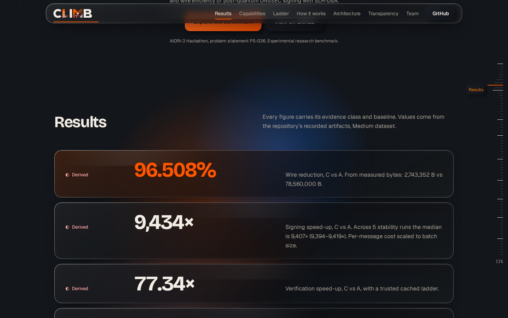
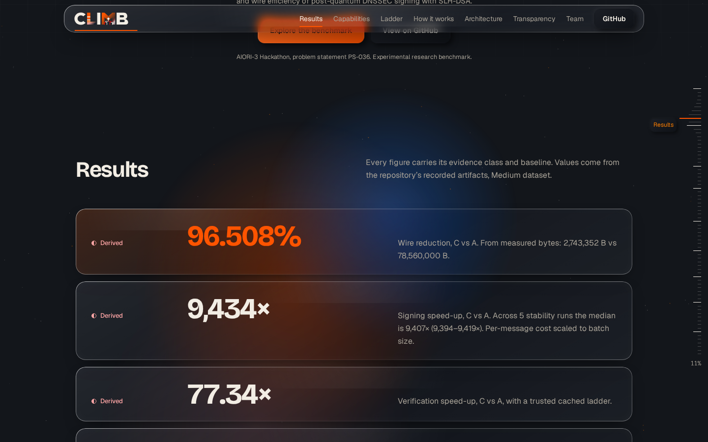

# Skin diffs — the glass scrim

The glass panels carry two accessibility additions on top of the prototype's
translucent fill: an ink scrim under the white gradient, and the pointer
specular clipped to the panel's top 44 px. This file records how the scrim's
opacity was chosen, from rendered pixels rather than from the CSS stop
composite alone.

Prototype: `docs/site/prototype/climb-site.html`, SHA-256
`0b0822338e004daba100bde1f98bcd9f2e5aa4c1f7b08198973d966a9570f108`.

## Method

`site/e2e/glass-contrast.spec.ts` runs in Playwright's Chromium at 1440×900 and
390×844, with a device scale factor of 1.

1. **Freeze the orbs.** Each `.orbs i` gets `animation-play-state: paused` and a
   negative `animation-delay`. The phase is chosen per panel: 24 candidate
   phases per orb are measured, and the phase whose orb centre is nearest the
   panel's body-text centroid wins. All three orbs are therefore stacked behind
   that panel's text, which is the worst composite the design can produce.
2. **Hide the text, keep its box.** A measurement-only class sets `color` and
   SVG `fill` to transparent and forces the reveal state. The panel is
   screenshotted, and each sampled pixel is the background under a text run.
3. **Sample every run.** Text nodes are walked inside `#hd`, `.led li`,
   `.tr>div`, `.lim`, `.dg`, `.arch`, `.dash` and `.tm li`. Runs inside a
   `display:none`, `visibility:hidden` or `opacity:0` ancestor are skipped.
   Each run's client rectangles are clamped to the panel; a panel that scrolls
   horizontally (`.arch` at 390 px) is measured at `scrollLeft: 0` and at its
   maximum, so labels on both halves are seen. The run is large text at
   `≥ 24 px`, or `≥ 18.66 px` at weight 700 or more.
4. **Compute the WCAG ratio** of the run's computed text colour against every
   pixel in its rectangles; the row records the worst ratio. The foreground is
   the element's `color`, or `fill` for SVG `<text>`/`<tspan>`. Translucent text
   is composited over each background pixel first.
5. **Search the scrim** from 0 % to 78 % in 6 % steps. The scrim is an alpha
   layer over a static backdrop, so the 0 % and 100 % frames are captured once
   per panel and every step is their linear blend. The chosen 36 % row is
   re-captured for every panel and compared with the blend (within 0.25), so the
   decision itself stands on a real frame.
6. **Compare with the prototype.** For each panel the harness also renders the
   prototype with the same orb phase, hides every descendant, and screenshots
   the bare glass. Both images are resized to 64 × 64 and the mean absolute
   per-channel difference is computed. `.dash` has no prototype counterpart;
   the prototype has four ledger rows against the port's five, so the first
   four are matched. The MAD column is therefore "how much darker the panel is
   than the prototype's", with the copy removed from the comparison.

The tables below are copied from the spec's output. The
`--edge` boundary is checked by the stop-composite in `scripts/site-check.py`,
because a 1 px mask-composited edge cannot be separated from the panel's
gradient by pixel sampling.

## The tables

```
1440 px viewport
scrim  worst-body  worst-large  MAD vs prototype  worst body / worst large
   0%        3.67         3.67              2.67  .tm li[0] "Team Lead and Developer" / .led li[0] "55.782"
   6%        3.84         3.71              3.92  .tm li[0] "Team Lead and Developer" / .led li[0] "55.782"
  12%        4.02         3.75              5.44  .tm li[0] "Team Lead and Developer" / .led li[0] "55.782"
  18%        4.20         3.79              7.03  .tm li[0] "Team Lead and Developer" / .led li[0] "55.782"
  24%        4.39         3.83              8.64  .tm li[0] "Team Lead and Developer" / .led li[0] "55.782"
  30%        4.58         3.87             10.26  .tm li[0] "Team Lead and Developer" / .led li[0] "55.782"
  36%        4.75         3.91             11.89  .tm li[0] "Team Lead and Developer" / .led li[0] "55.782"
  42%        4.97         3.95             13.52  .tm li[0] "Team Lead and Developer" / .led li[0] "55.782"
  48%        5.04         3.99             15.16  #hd[0] "Capabilities" / .led li[0] "55.782"
  54%        5.10         4.03             16.80  #hd[0] "Capabilities" / .led li[0] "55.782"
  60%        5.16         4.07             18.44  #hd[0] "Capabilities" / .led li[0] "55.782"
  66%        5.18         4.11             20.08  .dash[0] "Open full screen" / .led li[0] "55.782"
  72%        5.18         4.16             21.73  .dash[0] "Open full screen" / .led li[0] "55.782"
  78%        5.18         4.20             23.38  .dash[0] "Open full screen" / .led li[0] "55.782"
```

```
390 px viewport
scrim  worst-body  worst-large  MAD vs prototype  worst body / worst large
   0%        3.68         3.21              2.37  .arch[0] "Artifacts" / .led li[0] "%"
   6%        3.84         3.34              3.29  .arch[0] "Artifacts" / .led li[0] "%"
  12%        4.00         3.48              4.80  .arch[0] "Artifacts" / .led li[0] "%"
  18%        4.18         3.61              6.44  .arch[0] "Artifacts" / .led li[0] "%"
  24%        4.35         3.75              8.12  .arch[0] "Artifacts" / .led li[0] "%"
  30%        4.54         3.89              9.81  .arch[0] "Artifacts" / .led li[0] "%"
  36%        4.71         4.04             11.51  .arch[0] "Artifacts" / .led li[0] "%"
  42%        4.92         4.18             13.22  .arch[0] "Artifacts" / .led li[0] "%"
  48%        5.12         4.33             14.93  .arch[0] "Artifacts" / .led li[0] "%"
  54%        5.18         4.48             16.65  .dash[0] "Open full screen" / .led li[0] "%"
  60%        5.18         4.63             18.37  .dash[0] "Open full screen" / .led li[0] "%"
  66%        5.18         4.77             20.09  .dash[0] "Open full screen" / .led li[0] "%"
  72%        5.18         4.92             21.81  .dash[0] "Open full screen" / .led li[0] "%"
  78%        5.18         5.01             23.53  .dash[0] "Open full screen" / .led li[0] "66.354"
```

The chosen value is **36 %**. It is the first 6 % step whose stop-composite
clears every floor: muted `4.65:1`, `--or2` `4.57:1`, rose `6.24:1`, large
orange `3.62:1`, `--edge` `3.58:1` over the cool orb. On pixels the body floor
is already met at 30 % (4.54:1 at 390 px and 4.58:1 at 1440 px), but the
conservative composite does not, so 36 % is the smallest value that keeps both
the fast pre-check and the rendered rule green. At 30 % the composite reports
muted `4.46:1`; at 36 % it reports `4.65:1`. The chosen row above is a real
capture at 36 %, not the blend; every other row is the linear blend of the 0 %
and 100 % captures, and the spec asserts the real frame agrees with the blend
within 0.25 for every panel.

The scrim was not raised to the previous 78 %: that value was chosen from the
composite alone and leaves roughly half the orb character of the prototype. The
MAD column at 36 % is 11.89 (1440 px) and 11.51 (390 px) against 23.38 and
23.53 at 78 %.

## Before and after

Same viewport, same frozen orb phase, same scroll position; only
`--glass-scrim` changes.





The first image is the value this phase replaced; the second is the value it
chose. The 44 px specular clip stays in both, so the difference is the ink layer
only.

## Deviations from the prototype

| Prototype | Port | Why |
| --- | --- | --- |
| the panel fill is the white gradient over the blurred backdrop | an ink scrim at 36 % is painted first | the composite leaves muted text below 4.5:1 over the cool orb and the previous 78 % hid the orbs |
| the pointer specular follows the pointer across the whole panel | clipped to the panel's top 44 px | at `.16` under text, muted copy falls below 4.5:1 |
| `--ln` is the resting border of every control | `--edge` (paper at 48 %) on controls with no other affordance | `--ln` is 1.32–1.44:1, below the 3:1 boundary floor; `--edge` is 3.58–3.74:1 on glass |
| `--or` is the accent everywhere | `--or2` for 13 px marks; `--or` on glass is the large ledger numeral | `--or` is 3.62:1 on glass, so it is large-text only; the body-sized marks use `--or2` (4.57:1) |

## What was not verified

- **Real GPU compositing.** Chromium's software raster at device scale factor 1
  only. The `backdrop-filter` blur can land differently on a real GPU, in
  Safari or in Firefox.
- **A physical phone.** The 390 × 844 viewport is emulated; safe-area insets,
  the dynamic browser chrome and touch scrolling are not part of the sample.
- **A screen reader.** The text is present in the DOM and the contrast is
  measured, but no NVDA or VoiceOver pass was run.
- **The horizontally scrolled `.arch` at intermediate offsets.** The harness
  samples the two ends; a label that is only visible mid-scroll uses the same
  glass stack.

## Reproduce

```sh
cd site
PLAYWRIGHT_BROWSERS_PATH=0 npx playwright test e2e/glass-contrast.spec.ts
```

Add `GLASS_ARTIFACTS=1` to rewrite the two images above. The stop-composite is
`python3 scripts/site-check.py contrast`.
